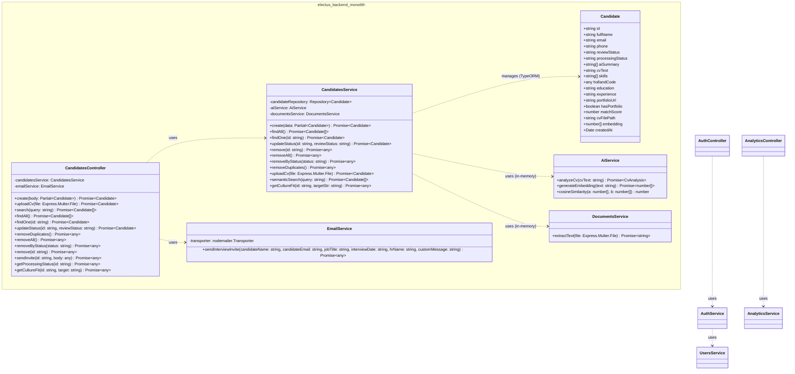

# Electus: AI-Powered Applicant Tracking System (ATS)


Electus is a state-of-the-art Applicant Tracking System (ATS) designed to modernize the hiring process. Built for modern HR teams, Electus goes beyond simple keyword matching by implementing **Retrieval-Augmented Generation (RAG)** and Hybrid Semantic Search. It understands the *context* of a candidate's CV and matches them accurately to complex queries using vector embeddings and database-level cosine similarity.

## Key Features

* **Database-Driven Hybrid Semantic Search (RAG):** Powered by Ollama Embeddings (`nomic-embed-text`) and SQL-level cosine similarity scoring. Search for candidates using natural language (e.g., *"Find a detail-oriented backend developer with leadership skills"*). Combines vector similarity with full-text search directly in PostgreSQL for speed and memory efficiency.
* **In-Memory Automated CV Processing:** Instantly extracts text from uploaded **PDFs** (via `pdf-parse`) and **DOCX** files (via `mammoth`) directly in-memory with zero network overhead, then generates an AI Summary, Skills Extraction, and Holland Code (RIASEC) personality assessment for every candidate using a local LLM (`llama3.1`).
* **Unbiased Hiring (Blind Screening):** A built-in toggle to hide candidate names and photos, promoting objective and equitable talent acquisition.
* **Smart Dashboard Analytics:** Real-time metrics and talent pool insights (Hiring Pipeline, Skill Distribution, Holland Code Distribution) calculated dynamically from the database and displayed in a responsive Bento-box layout.
* **Liquid Glass UI:** A highly polished, futuristic Glassmorphism interface with a WebGL-powered animated landing page that delivers a premium user experience.
* **Bulk Management:** Bulk delete tools (Delete All, Remove Duplicates, Clear by Status) with confirmation dialogs to prevent accidental data loss.

## Tech Stack

**Frontend:**
* React 18 / Vite
* TypeScript
* Tailwind CSS (Glassmorphism / Liquid Glass styling)
* Shadcn/UI
* Recharts (Analytics charts)
* Three.js (WebGL shader for landing page)

**Backend (Modular Monolith):**
* NestJS Modular Monolith (`electus-app`)
* TypeORM & PostgreSQL (native float array embeddings & SQL cosine similarity)
* Ollama (Local LLM — `llama3.1` for CV analysis, `nomic-embed-text` for vector embeddings)
* Mammoth (DOCX text extraction)
* pdf-parse (PDF text extraction)

## Backend Class Diagram

Struktur kelas arsitektur backend Modular Monolith Electus:



## System Architecture

```text
 ┌──────────────┐        ┌───────────────────────────────────────┐
 │  Frontend    │───────▶│  electus-app (Modular Monolith)       │
 │  React/Vite  │◀───────│  Candidates • Auth • Analytics • Users│
 │  :5173       │        │  Documents Module • AI Module         │
 └──────────────┘        └──────┬──────────────────────┬─────────┘
                                │                      │
                                ▼                      ▼
                     ┌──────────────────┐   ┌─────────────────────────┐
                     │  PostgreSQL      │   │  Ollama (Local AI)      │
                     │  Candidates DB   │   │  llama3.1 + nomic-embed │
                     │  + Vector Search │   │  :11434                 │
                     └──────────────────┘   └─────────────────────────┘
```

### Pipeline Flow

1. **Ingestion:** CVs (PDF/DOCX) di-upload ke `electus-app` → `DocumentsModule` mengekstrak teks langsung secara in-memory (tanpa overhead jaringan Base64) → `AiModule` menganalisis data terstruktur dengan Ollama `llama3.1` dan membuat embedding dengan `nomic-embed-text` → data dan vektor embedding disimpan di PostgreSQL.
2. **Retrieval & Ranking:** Query HR dievaluasi langsung di PostgreSQL SQL menggunakan fungsi `cosine_similarity(c.embedding, :queryEmbedding)` dan pencarian kata kunci dengan pembatasan `LIMIT 50`. Menghasilkan ranking kandidat akurat tanpa risiko kehabisan memori RAM di server.

## Getting Started

### Prerequisites

* **Node.js** (v18+)
* **PostgreSQL** (v14+)
* **Ollama** — [Download here](https://ollama.ai)

### 1. Setup Ollama (Local AI)

```bash
# Install and pull required models
ollama pull llama3.1          # For CV analysis
ollama pull nomic-embed-text   # For vector embeddings

# Ensure Ollama is running
ollama serve
```

### 2. Setup Database

```bash
# Create the database in PostgreSQL
psql -U postgres -c "CREATE DATABASE electus;"
```

### 3. Setup Backend

```bash
cd electus-app

# Install dependencies
npm install

# Configure environment variables
cp .env.example .env
# Edit .env with your database credentials

# Start the development server
npm run start:dev
# Backend runs on http://localhost:3000
```

### 4. Setup Frontend

```bash
cd electus-frontend

# Install dependencies
npm install

# Start the development server
npm run dev
# Frontend runs on http://localhost:5173
```

### One-Click Startup (Windows / macOS)

* **Windows:** Jalankan `start-electus.bat`
* **macOS / Linux:** Jalankan `./start-backend.command`

## Project Structure

```
electus-project/
├── electus-app/                    # Modular Monolith Backend (NestJS)
│   └── src/
│       ├── ai/                          # In-process Ollama AI client & scoring
│       ├── analytics/                   # Hiring dashboard metrics
│       ├── auth/                        # JWT Authentication & guards
│       ├── candidates/                  # Candidate domain, search & entities
│       ├── documents/                   # In-memory PDF & DOCX text extraction
│       ├── notifications/               # Notification service
│       ├── users/                       # User management & sessions
│       ├── app.module.ts
│       └── main.ts
│
├── electus-frontend/               # Frontend (React + Vite)
│   └── src/
│       ├── pages/                       # Landing, Login, SignUp, Dashboard, Statistics
│       ├── components/                  # Layout, Candidate cards, Modals, UI components
│       └── types/                       # TypeScript interfaces
│
├── docs/                           # Implementation plan & task tracker
│   └── tasks.md
│
├── start-electus.bat               # Windows one-click launcher
├── start-backend.command           # macOS/Linux launcher
└── README.md
```

## Running Tests

```bash
cd electus-app
npm test
```

---

*Built with ❤️ for a smarter hiring future.*
