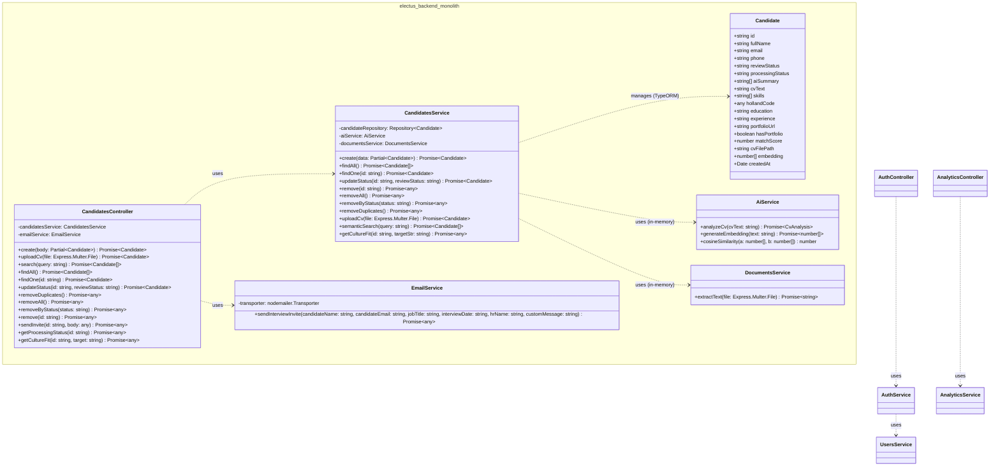

# Electus: AI-Powered Applicant Tracking System (ATS)


Electus is a state-of-the-art Applicant Tracking System (ATS) designed to modernize the hiring process. Built for modern HR teams, Electus goes beyond simple keyword matching by implementing **Retrieval-Augmented Generation (RAG)** and Hybrid Semantic Search. It understands the *context* of a candidate's CV and matches them accurately to complex queries using vector embeddings and database-level cosine similarity.

## Key Features

* **Database-Driven Hybrid Semantic Search (RAG):** Powered by Gemini Embedding (`gemini-embedding-2`) and SQL-level cosine similarity scoring. Search for candidates using natural language (e.g., *"Find a detail-oriented backend developer with leadership skills"*). Combines vector similarity with full-text search directly in PostgreSQL for speed and memory efficiency.
* **In-Memory Automated CV Processing:** Instantly extracts text from uploaded **PDFs** (via `unpdf`) and **DOCX** files (via `mammoth`) directly in-memory with zero network overhead, then generates an AI Summary, Skills Extraction, and Holland Code (RIASEC) personality assessment for every candidate with Gemini.
* **Unbiased Hiring (Blind Screening):** A built-in toggle to hide candidate names and photos, promoting objective and equitable talent acquisition.
* **Smart Dashboard Analytics:** Real-time metrics and talent pool insights (Hiring Pipeline, Skill Distribution, Holland Code Distribution) calculated dynamically from the database and displayed in a responsive Bento-box layout.
* **Liquid Glass UI:** A highly polished, futuristic Glassmorphism interface with a WebGL-powered animated landing page that delivers a premium user experience.
* **Bulk Management:** Bulk delete tools (Delete All, Remove Duplicates, Clear by Status) with confirmation dialogs to prevent accidental data loss.

## Tech Stack

**Frontend:**
* React 18 / Vite
* TypeScript
* Tailwind CSS (Glassmorphism / Liquid Glass styling)
* Shadcn/UI
* Recharts (Analytics charts)
* Three.js (WebGL shader for landing page)

**Backend (Modular Monolith):**
* NestJS Modular Monolith (`electus-app`)
* TypeORM & PostgreSQL (native float array embeddings & SQL cosine similarity)
* Gemini API (CV analysis and embeddings)
* Mammoth (DOCX text extraction)
* unpdf (PDF text extraction)

## Backend Class Diagram

Struktur kelas arsitektur backend Modular Monolith Electus:



## System Architecture

```text
 ┌──────────────┐        ┌───────────────────────────────────────┐
 │  Frontend    │───────▶│  electus-app (Modular Monolith)       │
 │  React/Vite  │◀───────│  Candidates • Auth • Analytics • Users│
 │  :5173       │        │  Documents Module • AI Module         │
 └──────────────┘        └──────┬──────────────────────┬─────────┘
                                │                      │
                                ▼                      ▼
                     ┌──────────────────┐   ┌─────────────────────────┐
                     │  PostgreSQL      │   │  Gemini API             │
                     │  Candidates DB   │   │  llama3.1 + nomic-embed │
                     │  + Vector Search │   │  :11434                 │
                     └──────────────────┘   └─────────────────────────┘
```

### Pipeline Flow

1. **Ingestion:** CVs (PDF/DOCX) di-upload ke `electus-app` → `DocumentsModule` mengekstrak teks langsung secara in-memory (tanpa overhead jaringan Base64) → `AiModule` menganalisis data terstruktur dengan Gemini Flash-Lite (fallback Flash) dan membuat embedding dengan Gemini Embedding → data dan vektor embedding disimpan di PostgreSQL.
2. **Retrieval & Ranking:** Query HR dievaluasi langsung di PostgreSQL SQL menggunakan fungsi `cosine_similarity(c.embedding, :queryEmbedding)` dan pencarian kata kunci dengan pembatasan `LIMIT 50`. Menghasilkan ranking kandidat akurat tanpa risiko kehabisan memori RAM di server.

## Getting Started

### Prerequisites

* **Node.js** (v18+)
* **PostgreSQL** (v14+)
* **Gemini API key** in `electus-app/.env`

After cloning, create `electus-app/.env` from `electus-app/.env.example` if the file does not exist. Fill in the PostgreSQL connection and `GEMINI_API_KEY`. The API uses port 3000 by default and the frontend uses port 8080.

Run from the repository root:

```sh
npm ci
npm run setup
npm --prefix electus-app run migration:run
npm run dev
```

Open http://localhost:8080. After setup, daily development only needs `npm run dev` with PostgreSQL running.

PDF text extraction runs locally with unpdf, and DOCX extraction uses Mammoth. The backend sends extracted text to Google Gemini for analysis and embedding. Scanned PDFs without a text layer require OCR before upload.

CV analysis defaults to `gemini-3.5-flash-lite` and switches to `gemini-3.8-flash` on a failed analysis. Set `GEMINI_MODEL` or `GEMINI_FALLBACK_MODEL` in `electus-app/.env` to override either model. Older 768-dimensional vectors remain available through keyword search until re-embedded in the new 1536-dimensional format.

## Project Structure

```
electus-project/
├── electus-app/                    # Modular Monolith Backend (NestJS)
│   └── src/
│       ├── ai/                          # Gemini API client & scoring
│       ├── analytics/                   # Hiring dashboard metrics
│       ├── auth/                        # JWT Authentication & guards
│       ├── candidates/                  # Candidate domain, search & entities
│       ├── documents/                   # In-memory PDF & DOCX text extraction
│       ├── notifications/               # Notification service
│       ├── users/                       # User management & sessions
│       ├── app.module.ts
│       └── main.ts
│
├── electus-frontend/               # Frontend (React + Vite)
│   └── src/
│       ├── pages/                       # Landing, Login, SignUp, Dashboard, Statistics
│       ├── components/                  # Layout, Candidate cards, Modals, UI components
│       └── types/                       # TypeScript interfaces
│
├── docs/                           # Implementation plan & task tracker
│   └── tasks.md
│
├── start-electus.bat               # Windows one-click launcher
├── start-backend.command           # macOS/Linux launcher
└── README.md
```

## Running Tests

```bash
cd electus-app
npm test
```

---

*Built with ❤️ for a smarter hiring future.*
