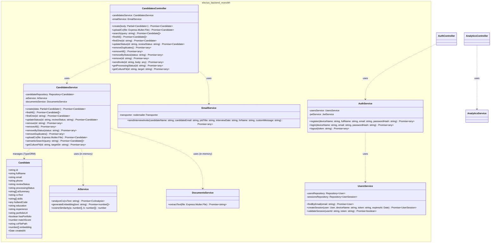

# Class Diagram: Electus Modular Monolith Backend

This class diagram represents the actual class structures, internal module dependencies, properties, and methods implemented in the Electus NestJS backend.

---

